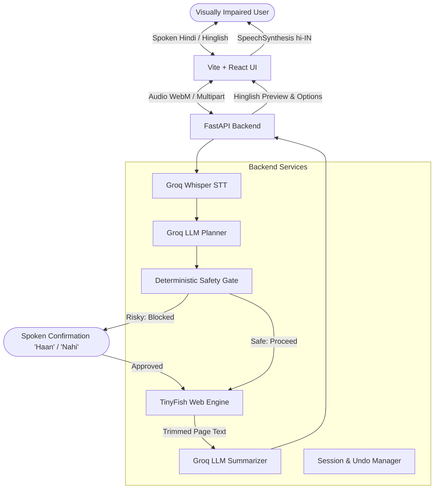

# AwaazWeb 🎙️🌐

> **Voice-first web navigator enabling visually impaired individuals to access any website autonomously via Hindi/Hinglish speech.**

Built for Hackathon by team **Dead Neurons**.

---

## 📌 The Problem
Over **90% of web services in India** (government portals, train bookings, bill payments, ecommerce, banking) are virtually inaccessible to visually impaired citizens without sighted assistance.

Traditional screen readers (like NVDA or TalkBack) fail on the modern web because they:
1. **Drown users in raw DOM noise**: They sequentially read hundreds of repetitive navigation links, header tags, SVG paths, and banner ads before reaching actual content.
2. **Break on dynamic Single Page Applications (SPAs)**: JavaScript dropdowns, multi-step booking wizards, and async modals baffle standard screen readers.
3. **Impose severe cognitive overload**: A blind user trying to find a train timing has to listen to 10+ minutes of raw site clutter.

---

## 💡 How AwaazWeb Works
AwaazWeb acts as an intelligent, autonomous bridge between the visually impaired user and the live web:

1. **One Big Button / Space Bar**: The user presses a giant high-contrast button (or taps Space) and speaks naturally in Hindi or Hinglish (e.g., *"Delhi se Bhopal ki kal ki train dhundho"*).
2. **Instant Transcription**: Groq Whisper (`whisper-large-v3`) transcribes the speech into text in under 1 second.
3. **Intent Planning**: A Groq LLM planner analyzes the request and produces a structured JSON navigation plan (`read` vs `act`).
4. **Autonomous Web Work**: TinyFish autonomously navigates the live web (Search/Fetch for information, streaming Action Agent for interactive flows, and Browser Context Profiles for saved logins).
5. **Trimmed Text Analysis**: AwaazWeb extracts clean, trimmed page text—never raw HTML—ensuring minimal token usage and fast turnaround.
6. **Conversational Synthesis**: A Groq LLM summarizer generates a concise Hinglish preview with **overview first** and **maximum 2–3 numbered choices**.
7. **Audio Delivery**: The browser speaks the summary aloud via `window.speechSynthesis` (auto-selecting a Hindi `hi-IN` voice) while playing subtle accessible audio cues.
8. **Reversible Actions & Always-Working Commands**: The user can interrupt at any point (*"ruko"*), request repetition (*"dobara bolo"*), or undo the last step (*"wapas jao"*).

---

## ✨ Features
- 🗣️ **Conversational Hindi & Hinglish**: Understands natural Indian speech and code-switching without rigid syntax.
- ⚡ **Near-Instant Voice Loop**: Powered by Groq's high-throughput LPU inference (~500 tokens/sec) and sub-second Whisper transcription.
- 🛡️ **Deterministic Safety Gate in Code**: Financial transactions, ticket bookings, form submissions, and data deletions are hard-blocked until the user explicitly speaks *"Haan"* (Yes). The LLM cannot override this gate.
- 🔐 **Zero-Credential Retention**: OTPs, passwords, and Captchas trigger a clean pause (`needs_user_input`) for user entry; AwaazWeb never guesses, logs, or stores secrets.
- 🌐 **Autonomous Browsing**: Uses TinyFish Search, Fetch, and streaming Agent execution to bypass screen reader roadblocks on modern SPAs.
- 🔄 **Reversible Action Stack & Audit Log**: Every action is recorded with before/after state snapshots for multi-step undo.
- 🛑 **Instant Interruption**: Saying *"ruko"* instantly halts active execution and returns to idle.
- 👁️ **Judge & Developer Trace View**: High-contrast `ActivityLog` streams the assistant's internal thought process and browsing milestones in real-time.

---

## 🏗️ Architecture



---

## 📂 Folder Structure

```
awaaz2/
├── backend/
│   ├── app/
│   │   ├── main.py              # FastAPI app, CORS, router mounting, /health
│   │   ├── config.py            # Environment loader, model defaults, key validation
│   │   ├── routes/
│   │   │   ├── voice.py         # /api/voice, /api/text (Voice loop & orchestrator)
│   │   │   ├── session.py       # /api/session, /api/session/{id}/undo, /log
│   │   │   └── confirm.py       # /api/confirm (Safety gate decision handler)
│   │   ├── services/
│   │   │   ├── llm.py           # The ONLY file calling Groq LLM completions
│   │   │   ├── stt.py           # Groq Whisper speech-to-text service
│   │   │   ├── planner.py       # Intent planning engine & special commands
│   │   │   ├── browser.py       # TinyFish search, fetch & streaming agent actions
│   │   │   ├── summarizer.py    # Short Hinglish voice preview generator
│   │   │   ├── safety.py        # Deterministic risk checks & spoken yes/no parser
│   │   │   └── history.py       # Action log & state snapshot undo manager
│   │   ├── prompts/
│   │   │   ├── planner.txt      # Planning prompt & JSON schema
│   │   │   ├── summary.txt      # Hinglish accessibility preview guidelines
│   │   │   └── safety.txt       # Action risk classification criteria
│   │   └── data/sessions/       # Persistent session files (.gitkeep)
│   ├── tests/
│   │   ├── test_health.py
│   │   ├── test_planner_schema.py
│   │   ├── test_readonly_browsing.py
│   │   ├── test_safety.py
│   │   ├── test_agent_actions.py
│   │   ├── test_history_undo.py
│   │   ├── test_voice_endpoint.py
│   │   ├── test_voice_loop.py
│   │   ├── sample_requests.md   # 15 Hinglish test phrases
│   │   └── test_flows.md        # End-to-end execution flow matrix
│   ├── requirements.txt
│   └── .env.example
├── frontend/
│   ├── src/
│   │   ├── components/
│   │   │   ├── TalkButton.jsx   # Giant accessible button with pulse animation
│   │   │   ├── StatusBanner.jsx # High-contrast state announcement banner
│   │   │   └── ActivityLog.jsx  # Live agent trace for sighted observers
│   │   ├── hooks/
│   │   │   ├── useRecorder.js   # MediaRecorder audio capture hook
│   │   │   └── useSpeaker.js    # SpeechSynthesis hook with hi-IN prioritization
│   │   ├── services/
│   │   │   ├── api.js           # Backend API integration client
│   │   │   └── soundEffects.js  # Web Audio sound effects (beeps & chimes)
│   │   ├── App.jsx              # Main accessible application container
│   │   ├── index.css            # High-contrast accessible design system
│   │   └── main.jsx
│   ├── public/sounds/           # Pre-synthesized audio cues (.wav)
│   └── vite.config.js           # Server proxy configuration
└── docs/
    ├── workflow.md              # Complete lifecycle trace with examples
    ├── demo-script.md           # 3-minute presentation script
    └── pitch-notes.md           # Problem, solution, FAQ & judge defense
```

---

## 🛠️ Prerequisites
- **Python**: 3.11 or higher (Python 3.14 verified)
- **Node.js**: 18.0 or higher (Node v24 verified)
- **Git**: 2.30+

---

## 🚀 Setup & Installation

### 1. Clone & Setup Backend
```bash
# From project root
cd backend
python3 -m venv venv
source venv/bin/activate
pip install -r requirements.txt
```

### 2. Configure Environment Secrets
Create `backend/.env` based on `backend/.env.example`:
```env
GROQ_API_KEY=your_groq_api_key_here
TINYFISH_API_KEY=your_tinyfish_api_key_here
GROQ_LLM_MODEL_FAST=qwen/qwen3.8-27b
GROQ_LLM_MODEL_STRONG=openai/gpt-oss-120b
GROQ_STT_MODEL=whisper-large-v3
MAX_AGENT_RUNS_PER_SESSION=5
FRONTEND_ORIGIN=http://localhost:5173
```

> [!CAUTION]
> **Privacy Note**: Secrets must live **only** in `backend/.env`. Never commit, log, or push API keys. Use dummy data during demos; never input real Aadhaar numbers, bank credentials, or active OTPs.

### 3. Setup Frontend
```bash
# In a new terminal from project root
cd frontend
npm install
```

---

## ▶️ Running the Application

### Start Backend
```bash
cd backend
source venv/bin/activate
uvicorn app.main:app --reload --port 8000
```
API runs on `http://localhost:8000`. Health endpoint: `http://localhost:8000/health`.

### Start Frontend
```bash
cd frontend
npm run dev
```
Accessible UI available at `http://localhost:5173`.

---

## 🧪 Testing

### Automated Pytest Suite
Run the 26-test suite covering health checks, planner schemas, TinyFish search, safety blocking, agent caps, and undo stacks:
```bash
cd backend
source venv/bin/activate
pytest tests/ -v
```

### Manual Voice Test Script
1. Open `http://localhost:5173`.
2. Tap the large circular microphone button or press <kbd>Space</kbd>.
3. Say: *"Delhi se Bhopal ki kal ki train dhundho"*.
4. Verify audio chime, real-time activity log trace, and spoken Hinglish preview with numbered options.
5. Say: *"Ticket book kar do"* — verify that the safety gate halts and reads back the exact action before asking for *"Haan"* or *"Nahi"*.
6. Say: *"Haan"* — verify completion, or *"Ruko"* to halt.

---

## 🔒 Safety & Privacy
- **Code-Enforced Gate**: Dangerous actions (`pay`, `book`, `submit`, `delete`, `send`) are blocked by deterministic regex rules in Python code. The LLM cannot authorize risky actions on its own.
- **Explicit Read-Back**: Before any irreversible step, AwaazWeb reads the exact action aloud and waits for the user to say *"Haan"*.
- **No Credential Storage**: Captchas and OTPs trigger a prompt for manual entry; they are never logged, remembered, or parsed into LLM memory.
- **Privacy Warning**: Because Groq free tier models operate in public cloud infrastructure, all hackathon demos must strictly utilize dummy test credentials.

---

## ⚠️ Limitations
- **Background Audio Interference**: Extreme background crowd noise can affect Whisper accuracy; noise-canceling headsets or typed fallback input are recommended in noisy auditoriums.
- **Complex Captchas**: Audio captchas or visual puzzles require sighted assistance or dedicated third-party accessibility solvers.
- **Free Quota Caps**: Protected by `MAX_AGENT_RUNS_PER_SESSION=5` to prevent free tier rate limits.

---

## 👥 Team & Credits
- **Team**: **Dead Neurons**
- **Infrastructure**: Groq LPUs (`whisper-large-v3`, `qwen/qwen3.8-27b`, `openai/gpt-oss-120b`) & TinyFish Web Agent Infrastructure.

---

## 🗺️ Roadmap
- [ ] Add direct WhatsApp voice note ingestion.
- [ ] Support regional Indian languages (Tamil, Telugu, Bengali, Marathi).
- [ ] Integrate local client-side Whisper WebAssembly for offline edge transcription.
- [ ] Expand Browser Context Profiles to multi-factor authenticated DigiLocker access.
